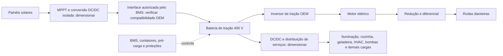

# Aurora Solar — arquitetura elétrica de trabalho

O motorhome tem **tração 100% elétrica** e acomoda ao menos duas pessoas, conforme I01 e o enunciado. A proposta D003 usa o E-Ducato MY25 L3H2 de 4250 kg. A configuração rastreável está em [arquitetura_eletrica_proposta.yaml](../config/arquitetura_eletrica_proposta.yaml), revisão `eletrica-0.1`; é uma proposta em desenvolvimento, sem aprovação final de engenharia.

## Base conferida

Fonte: Fiat Professional, ficha eslovaca de 20/03/2026, [PDF oficial](https://www.fiat.sk/content/dam/fiat2023/sk/cenniky/2026/03/e_Ducato_pricelist_dodavka_200326.pdf), acesso em 23/10/2026. PDF baixado em cache, 522504 bytes, SHA-256 `e3becec7275a4a13df61aa7fc5e8b0f6eb38ff6c3584d755d5b1bbd5f5e6224f`. Tabelas das páginas 1, 4 e 5 renderizadas e inspecionadas; página 2 consultada em texto. Não se incorporou o PDF do fabricante ao Git.

| Interface | Dado do fabricante | Localização |
|---|---|---|
| Variante | L3H2, 4250 kg, código 505.GG1.2 | p.1 |
| Motor | Síncrono de ímãs permanentes, 8 polos, tração dianteira; picos de 205 kW e 410 Nm | p.4 |
| Bateria | 110 kWh brutos, 98 kWh úteis, 400 V nominais, 15 módulos | p.4 |
| Carga externa | Conector CCS2; máximo DC anunciado de 150 kW | pp.2/4 |
| Carroceria | Comprimento 5,998 m, largura sem espelhos 2,050 m, entre-eixos 4,035 m; altura publicada 2,592–2,612 m | p.5 |
| Massa | 2790 kg em ordem de marcha sem motorista; limite 4250 kg; carga útil máxima publicada 1460 kg | p.5 e nota 1 |

As massas são da van original. A conversão, água, equipamentos, passageiros e carga precisam entrar em I18; componentes OEM já presentes não podem ser contados duas vezes. Não se assumiu que o limite de massa corresponde ao veículo pronto. A altura é uma faixa publicada, ainda sem selecionar um extremo como cota final.

## Fluxos de energia a especificar

O diagrama é funcional, não um esquema elétrico aprovado. A existência de CCS2 não comprova que o OEM aceite carga solar durante a condução. Essa interface é uma verificação obrigatória: especificar conversores, isolamento, permissões do BMS, compatibilidade de carga e tração simultâneas e eventual armazenamento auxiliar. Se incompatível, revisar a arquitetura e o despacho de energia; não contabilizar geração inacessível como energia útil de tração. A saída e-PTO anunciada também não demonstra capacidade de entrada solar.

## Verificação contra o trabalho

- **I01:** conceito elétrico solar para duas pessoas; nome de trabalho Aurora Solar.
- **I04/I05/I06/I09/I23:** há base OEM para motor, bateria e limites publicados. Faltam mapas de rendimento/torque por RPM, relação de transmissão, corrente/tensão de operação, química, massa do pack e perdas. Potência de pico não é potência contínua; não derivar eficiência ou curva real desses picos.
- **I07/I10/I30/I34/I35:** dimensionar cabos, proteções, dissipação e arrefecimento com as correntes e perdas reais. Os cenários de carga de 20/80 kW do professor permanecem; o limite OEM de 150 kW não os substitui.
- **I08/I25–I29:** módulos, teto útil, controladores, conversão e balanço diário ainda devem ser dimensionados. I25 usa somente a energia solar do dia; I26 usa km/kWh na bateria; I27 termina em SOC 30%; I29 permite apenas carga inicial e solar por 7000 km, até 8 h de direção por dia. SOC inicial 100% é hipótese declarada de cenário. Não afirmar que os painéis sustentam a velocidade de cruzeiro ou que a viagem já é viável.
- **I15–I19/I31/I32:** o CAD detalhado Ducato 2014 é uma referência externa de forma com cerca de 5 m. Não corresponde à van elétrica L3H2 de 5,998 m. Adaptar preservando detalhes e documentando cotas e áreas; recalcular geometria/CFD/térmica após a adaptação. Nenhum resultado aerodinâmico do modelo antigo pode ser atribuído automaticamente à versão elétrica.

## Próxima execução

1. Adaptar carroceria e layout para duas pessoas às cotas OEM; conferir teto, aberturas, equipamentos, bateria e distribuição de massas.
2. Resolver transmissão/mapas, integração solar/BMS, módulos, conversão e consumos auxiliares; atualizar interfaces com proveniência.
3. Executar CFD com superfície fiel, malha e convergência verificadas; integrar dinâmica, solar e autonomia.
4. Fechar térmica de cabos/bateria/motor, cabine, freios e arrefecimento com esses componentes; revisar os 35 itens e gerar memorial/figuras.

Revisão humana final permanece pendente. A escolha de trabalho permite desenvolver essas etapas sem inventar aprovação ou alterar silenciosamente os parâmetros globais.
