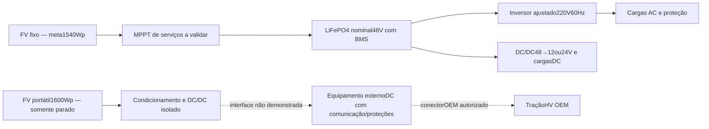
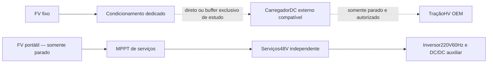
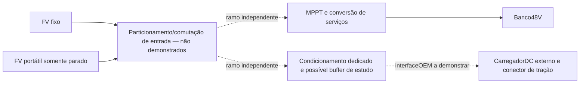

# Arquitetura elétrica conceitual — DEC001B,020,021,042,054

Estes são diagramas funcionais de estudo. Linhas para recargaDC indicam caminho que exige comprovação, não ligação construída. O packHV, BMS e cabosOEM permanecem inalterados. Banco48V de serviços não fornece nem recebe energia armazenada do pack de tração. Indicadores são os comerciais; controle porSOC ainda depende de BMS e atuadores.

## Alocação A — teto para serviços; portáteis para tração

## Alocação B — teto para tração; portáteis para serviços

FV de teto pode gerar durante o movimento; isso não autoriza sessão de carga externaDC com o veículo em movimento. Sem buffer, energia do ramo de tração durante movimento é cortada no modelo. Buffer dedicado, se futuramente aprovado, poderá acumular FV; serviços não o alimentam.

## Alocação C — geração comutada entre circuitos independentes

Estudar MPPT compartilhado requer curvasIV,strings,temperaturas,sombreamento,conectores,seccionamento e prevenção de retorno. Um equipamento com dois rastreadores é diferente de duas strings heterogêneas numa única entrada. Nenhuma saídaMPPT pode ser presumida ligada simultaneamente aos dois bancos. O módulo190W do arranjo histórico tem Vmp21,8V; MPPTbuck não o eleva para banco48V. A meta1540Wp permanece, mas o replay de48V usa1350Wp enquanto esse caminho não for demonstrado.

## Recarga direta versus buffer

|Critério|Direta|Buffer dedicado|
|---|---|---|
|Caminho|FV→condicionamento→carregadorDC externo→conectorOEM|FV→armazenamentoexclusivo→carregadorDC externo→conectorOEM|
|Mínimo operacional|Precisa manter potência/corrente de sessão reais|Pode acumular energia e fornecê-la em potência maior; ainda depende de mínimos/protocolo reais|
|Energia inicial no estudo|Somente tração e serviços já carregados|Buffer começa vazio; nunca fonte gratuita adicional|
|Perdas|MPPT/DC/DC/carregador/espera|As anteriores mais carga/armazenamento/descarga/espera|
|Massa,volume,custo|Equipamento ainda não demonstrado|Componentes e armazenamento adicionais sem modelo/custo aprovados|
|Parecer atual|Não demonstrado|Não demonstrado; não instalado nem incluído na massa-base|

O estudo varre mínimos hipotéticos, não fabricantes fictícios. [SungrowIDC30E](https://uk.sungrowpower.com/upload/file/20221215/EN%20FS%20IDC30E%20DC%20Charger%20Factsheet.pdf) tem alimentaçãoACtrifásica, mesmo com saídaDC; não é solução de entradaFV/DC. O [projeto4x4electric/Venema](https://4x4electric.com/first-time-solar-charging/) é evidência de outro conjunto testado, sem prova para esta variante. Potência nominal de carregador não define seu mínimo. Eficiência hipotética favorável não substitui compatibilidadeOEM.

## Verificações pendentes antes de qualquer implementação

P2 deve produzir tabela de circuitos e dispositivos reais: limitesDC da bateria/BMS, corrente de falta e interrupção, cabos/terminais e agrupamento, seccionamento, fusíveis, proteçãoAC contra choque/sobrecorrente, topologia neutro/PE e coordenação. O manual do inversor deve orientar seus relés de terra e a análise da instalação; não se presume que regras prediais isoladas certifiquem um veículo.

O plano de ensaios continua **planejado**: inspeção/polaridade, continuidade/equipotencialização, isolação, comandosBMS, falhas de comunicação, desligamentos, picos/partidas, temperatura de terminais/cabos e proteções sob condições seguras por responsável habilitado. Resultados deste repositório são **simulados**, sem ensaio físico ou certificação.
