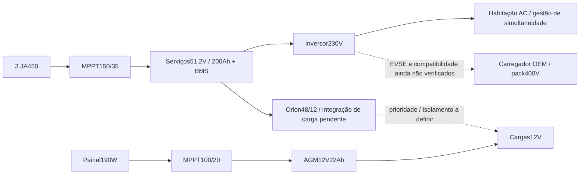

# Integração da tração e serviços — 25/10/2026

O CAD agora inclui bateria de tração, motor dianteiro, redutor/diferencial,
inversor de tração, carregador AC, radiador/ventiladores, banco de serviços,
inversor230V, BMS, MPPTs, conversor48→12V, quadro e rotas ilustrativas.
São **208 sólidos**, exportados e reimportados em STEP com volumes positivos.
O visualizador offline possui **23 seletores**; a vista técnica retira a carcaça,
interior e cobertura. O A/C já existente sob a cama ganhou dutos conceituais e
seleção isolada, para poder ser inspecionado.

## Dados de fabricante e hipóteses

As cotas do trem de força não foram encontradas nas fontes OEM consultadas.
Por isso pack2,90×1,44×0,32m, motorØ0,36×0,42m, redutor, inversor, carregador,
radiador e posições são **envelopes autorais estimados**, não CAD OEM.
Pack110kWh bruto/98útil/400V/15módulos e motor205kW/410Nm pico seguem a
[ficha Fiat MY25](https://www.fiat.sk/content/dam/fiat2023/sk/cenniky/2026/03/e_Ducato_pricelist_dodavka_200326.pdf).
O arranjo5×3 de módulos é ilustração; não reconstitui a bateria Fiat.
Vão livre230mm e folga130mm até o piso são hipóteses geométricas.
O eixo dianteiroX1,5417m coincide com o marco do CAD adaptado existente.

Não transferir documentação de bateria47/79kWh de2021 ao modelo110kWh.
Buscas por ficha de resgate/bodybuilder atual não forneceram desenho dimensional
primário adequado nesta etapa. A posição sob piso continua proposta de integração
até conferir desenho de longarinas, proteção, fixações e acesso OEM.

| Componente candidato de serviços | Quantidade | Dimensões CAD X/Y/Z (mm) | Massa (kg) |
|---|---:|---|---:|
| Victron Lithium NG51,2V100Ah | 2 paralelo | 648/162/235 | 37 cada, estimativa publicada |
| MultiPlus-II48/5000/70-50 230V | 1 | 320/149/565 | 30 |
| Lynx Smart BMS NG500A | 1 | 180/80/190 | 1,9 |
| SmartSolar150/35 | 1 fixo +1 extensão opcional | 186/70/130 | 1,25 cada |
| SmartSolar100/20 | 1 | 131/60/100 | 0,65 |
| Orion-Tr48/12-30 isolado | 1 | 186/80/130 | 1,8 |
| AGM12V22Ah BAT212200084 | 1 | 181/77/167 | 5,8 |

Fontes primárias consultadas25/10/2026: [NG51,2V](https://www.victronenergy.com/media/pg/Lithium_NG_battery_51,2_V/en/technical-data.html),
[MultiPlus especificações](https://www.victronenergy.com/media/pg/MultiPlus-II_230V/en/technical-specifications-mp-ii-230v.html),
[instalação MultiPlus](https://www.victronenergy.com/media/pg/MultiPlus-II_230V/en/installation.html),
[BMS](https://www.victronenergy.com/media/pg/Lynx_Smart_BMS_NG/en/technical-specifications.html),
[MPPT150](https://www.victronenergy.com/media/pg/Manual_SmartSolar_MPPT_150-35__150-45/en/technical-specifications.html),
[MPPT100](https://www.victronenergy.com/media/pg/Manual_SmartSolar_MPPT_75-10_up_to_100-20/en/technical-specifications.html),
[Orion](https://www.victronenergy.com/upload/documents/Datasheet-Orion-Tr-DC-DC-converters-isolated-100-250-400W-EN.pdf),
[AGM catálogo2025](https://www.victronenergy.com/upload/documents/Brochure_MARINE_EN_2025.pdf).
Hashes e cache em `proveniencia_eletrica.json` na entrega; não redistribuir PDFs brutos.

## Aproveitamento dos espaços e acesso

Foi usada como referência a [gaveta sob cama da Hymer](https://www.hymer.com/gb/en/service/hymer-original-parts-and-accessories/schrankauszug),
sem copiar CAD de terceiros. A implementação autoral acrescenta gaveta e trilhos
no volume livre acima do tanque, com acesso traseiro; fixação e retenção em viagem
ainda precisam de cálculo. O banco48V fica baixo sob cama, à frente da lava-seca,
sem invadir o envelope nominal dos equipamentos existentes.

O armário elétrico fica na lateral oposta à água, com anteparo/teto/bandeja
metálicos e faixas de lamelas para acesso e ventilação. Inversor vertical,
reserva100mm nos lados/superior/inferior e componentes lado a lado, sem inverter
diretamente sobre as baterias. O anteparo não é estrutura calculada, nem tem
classificação de reação ao fogo comprovada. O ar da AGM deve ser conduzido ao
exterior; lamelas internas sozinhas não comprovam ventilação adequada.
O dimensionamento da ventilação e da resistência aos30kg do inversor continua aberto.

A triagem AABB dos **23 envelopes de equipamentos** não encontrou sobreposição.
Não inclui chapa/longarina/caixa de roda/isolamento/abertura das portas nem todas
as rotas. Os cabos e dutos desenhados indicam percursos funcionais, não chicote
ou rede de ar aprovados. O orçamento de pressão/vazão dos três dutos60mm,
condensador pelo piso, retorno e drenagem de condensado ainda falta.

## Banco, massa e circuito proposto

Dois módulos em paralelo: **51,2V/200Ah/10,24kWh nominais**;200A contínuos de
bateria na condição nominal da ficha. A escolha de200Ah atende ao mínimo do
manual MultiPlus48/5000. Com DoD80% assumido, energiaDC8,192kWh antes de perdas,
sem creditar essa energia à bateria de tração. BMS NG externo é necessário.

Recomendação de instalação do inversor: fusívelDC200A e cobre70mm² por polo
até5m, **não dimensionamento do cabo de tração**. Script calcula sensibilidade
com2m por polo, rho20=1,724e−8Ωm/alpha0,00393K⁻¹/eta0,90 assumidos, a20/60/90°C
e44,8/51,2/56,8V. As temperaturas são entradas, não solução multidimensionalI30.
Faltam isolamento, ampacidade, agrupamento, proteção coordenada e curto-circuito.

Massa adicional conhecida dos serviços fixos: **115,4kg**; MPPTextra+1,25kg.
Subtotal OEM+interior conhecido+pessoas/água assumidas+teto fixo+serviços =
**3373,355kg**, saldo atéPBT876,645kg **antes dos itens faltantes**. Inclui os2,3kg
da indução brasileira selecionada nesta revisão.
Não somar pack/motor/redutor/inversorOEM de novo: já estão nos2790kg.
Sensibilidade independente de pack:110000Wh/(140/170/200Wh/kg assumidos)
→785,7/647,1/550kg, sem transformar hipóteses em massaOEM ou carga de eixos.

## Execução restante, na ordem

1. A induçãoEMEA50Hz foi substituída por **ElectroluxIE3TP220V/60Hz/2000W**,
   280×358×62mm e2,3kg, sobre bancada contínua. Manual2025p17 especifica2000W
   para220V, enquanto a loja mostra1500W genéricos: usar o manual da variante.
   [Manual primário](https://api.electrolux-medialibrary.com/asset/e295c711-5ce0-44d6-8d54-265bb08e664a/E4RM3Q/250717TCLQ/PDF/250717TCLQ.pdf).
   Com meia hora diária assumida, consumo residencial sem secagem passou de5,42651
   para5,27651kWh/dia; saldo solar fixo0,23034kWh antes de armazenamento/conversão.
   Fechar faixa de tensão dos demais aparelhos e configurar frequência do inversor.
   Resolver simultaneidade, EVSE/terra/DR,
   prioridade12V, retorno de corrente e carregamentoAGM antes de liberar circuito.
2. Conferir plantaOEM/rodas/estrutura/portas; completar suportes, fixações,
   tubulação de A/C, ventilação, dissipação e orçamento de massas/eixos/custos.
3. Obter mapas de motor/redução/Cr e pack, executar casos físicosI30/33/34/35,
   concluir CFD equipado com camadas/independência e atualizar missõesI25–29.
4. Revisar os35itens, consolidar memorial final, preparar seminário e vídeo humano.
5. **Somente depois:** logo Aurora Solar e pintura/grafismos externos de motorhome,
   conforme pedido explícito do usuário; não antecipar essa decoração.
6. Publicar no GitHub autorizado quando a entrega estiver pronta; sem push nesta etapa.

Reprodução: `scripts/gerar_cad_eletrico.py --destino NOVO`,
`scripts/calcular_integracao_eletrica.py --destino NOVO`, viewer exige
`--cad-eletrico NOVO/tracao_e_servicos.glb`. Usar `.venv/bin/python` na worktree.
O script de consolidação recebe caches explicitamente; não executar o consolidado
solar antigo sobre estes arquivos novos.
