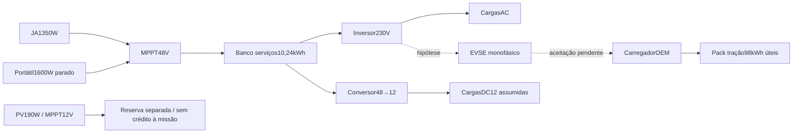

# Interface de carga e separação dos barramentos — 27/10/2026

Continuação da [agenda portátil](AGENDA_PORTATIL_2026-10-27.md), agora com
separação explícita de solar12/48V, perdas por conversão, perfis horários e carga
discreta. **Estudo condicionado; interface OEM não comprovada; nenhum item aprovado.**

## Correção do alcance da etapa anterior

A agenda anterior usava `mixed_stowed_w`, soma da string JA1350W em48V com o
painel190W ligado ao MPPT12V. A hipótese de transferênciaHV era explícita,
mas também faltava demonstrar a transferência dessa parcela12V ao banco48V.
Esta etapa credita somente a coluna `terminal_assumed_3_modules_w` ao banco48V:
**4,848752kWh/dia**. Mantém portátil8,119545kWh/dia quando aberto durante todo o
sol, total48V12,968297kWh/dia. Os **0,658097kWh/dia do painel12V** ficam separados,
sem crédito à missão. Não se inventa um conversor12→48V nem se conta duas vezes
a energia. O arquivo de entrada exportado conserva ambos os perfis.

É uma política conservadora: cargasDC12 assumidas são supridas pelo conversor
48→12, sem aproveitar a geração12V ou descarregar a AGM neste estudo. A
coordenação real desse barramento ainda exige projeto; não se afirma que esse
descarte seja necessário numa instalação final.



Diagrama funcional de estudo, sem especificação final de conexões/proteções.

## Evidência de componente e fronteira OEM

O [manual primárioNRGkick](https://nrgkick.com/wp-content/uploads/Bedienungsanleitung-DE-EN-FR-NL-TR.pdf),
versão2602-04-1, p20, foi baixado e essa página foi renderizada/conferida:
230/400V,50/60Hz; variante16A/cabo5m aproximadamente2,55kg; invólucro
216×90×64mm. O [folheto16A do fabricante](https://nrgkick.com/wp-content/uploads/20250703_Folder-16A-und-light_web_EN_05.pdf)
mostra alimentação monofásica com adaptador3polos. **É candidato, sem compra,
homologação do conjunto ou acréscimo silencioso à massa final.**

PDF4.040.492bytes, SHA256`d7ef4be369554196dea4b591d0aa2863fd364ae1abeb7e19c36d0889d1ae7a36`,
cache`interface-fontes-01/`; fonte registrada no catálogo, PDF fora do Git.
O manualp10 esclarece que a corrente anunciada limita a carga; o veículo pode
aceitar menos. Logo, corrente selecionada não comprova potência absorvida OEM.

O [manual MultiPlus-II](https://www.victronenergy.com/media/pg/MultiPlus-II_230V/en/technical-specifications-mp-ii-230v.html)
publica saída configurável60Hz e, para48/5000,4000W25°C/3700W40°C,
5000VA25°C e18W em vazio. Fonte previamente em cache, conferida online27/10.
O estudo usa3700W como teto ativo e5000VA como referência aparente nominal;
derating aparente a40°C e transientes ainda não demonstrados. A eficiência
constante90% é **hipótese**, não o pico96% tratado como curva real.

Não foi obtida evidência suficiente de aceitação **monofásica230V/60Hz pelo
OBC do E-DucatoMY25 escolhido**. Os11kW AC da ficha não provam essa condição.
Também faltam faixa de tensão dos aparelhos220V, desempenho em carga parcial,
neutro/PE/DR/disjuntores, intertravamentos e permissõesBMS. Os sensores de
proteção anunciados pelo EVSE não constituem aprovação desse circuito.

## Novo despacho e hipóteses de operação

`config/interface_carga_proposta.yaml`, módulo`interface_carga.py` e script
`calcular_interface_carga.py`; fonte/máquina de estados anteriores preservadas.
Cada passo30min recebe um modo de carga0/6/8/10A, constante no passo inteiro.
Esses modos são escolhas do estudo, sem garantir resposta do OBC. Transferência
continua bloqueada em qualquer passo com condução. Não há alimentação externa.

```
P_AC_carga = 230 * I * PF_carga / 1000
P_DC_transferência = P_AC_carga / eta_inversor
P_pack = P_AC_carga * eta_OBC
P_casa_DC = P_casa_AC / eta_inversor + P_cargas_DC12 / eta_DC_DC + P_vazio_inversor
```

Hipóteses: PFcarga0,99/PFcasa0,90; eta inversor/OBC/DC-DC0,90 cada;
5W de standbyEVSE assumidos e18W contínuos de vazio do inversor adicionados a
perdas proporcionais. Trata-se de modelo afim conservador, não curva medida.
Eficiência combinada da transferência81%. Potências ativas e aparentes da casa
e do carregador são verificadas conjuntamente, além do limite360W do DC-DC.

O orçamento residencial anterior foi repartido: A/C12–15h, fogão19–19h30;
lavagem fria permanece média semanal distribuída; geladeira e
luzes/bomba/eletrônica são cargasDC uniformes. O perfil não representa medição
de uso e não inclui secagem. Demanda do banco48V: **6,428118kWh/dia**, incluindo
perdas e standby. Picos/partidas e harmônicos não estão validados.

No cálculo de simultaneidade,10A com fogão excedem3700W e são vetados;6A podem
caber nesse limite de potência ativa. Isso não atesta segurança ou compatibilidade
do aparelho. A agenda ótima encontrada não carrega durante o uso do fogão.

## Resultados condicionados

| Caso | Resultado | Interpretação |
|---|---:|---|
| I27 sem interface | 326,402651km | Tração100→30%, serviços80→80%; sem8h emI27 |
| I27 com interface hipotética | 344,767978km | Ótimo na grade/modos, não autonomia física validada |
| I29 primeiro dia | 312,331887km | Até8h de condução; tração100→30% |
| I29 ciclo diário | 24,376711km | Tração30→30%, serviços80→80% |
| I29 construção7000km | 276dias inteiros | Primeiro+274ciclos+último8,449272km; não mínimo global |

I27 usa6,072000kWh na transferência, entrega4,918320kWh ao pack e dissipa
1,153680kWh nesse caminho; demanda total de tração73,518320kWh. SOC inicial
100% e final30% são frações da janela útil98kWh, não calibração do indicadorOEM.

No ciclo deI29,6,325000kWh entram no caminho e5,123250kWh chegam ao pack;
0,215179kWh solares são cortados. A agenda encontrada tem cinco inícios de
carga por dia cíclico; não há custo/tempo de handshake medido nem limite de
ciclos de contatores validado. Essa é outra condição a rever fisicamente.

Os276dias incluem esperas/serviços até meia-noite final. São Carlos21jun claro
se repete em todos os dias; não é previsão da rota/clima ou mínimo contínuo de
tempo. O aumento frente aos202dias anteriores resulta conjuntamente de retirada
do crédito12V, perfis horários, standby, perdas e discretização; não atribuir a
diferença inteira a um único fator. A comparação de15min anterior não valida
automaticamente esta nova formulação discreta.

## Reprodução e controles

[Suplemento com CSV/JSON/figuras](../entregas/etapa_2026-10-27_interface_carga/README.md).
Caches finais:`interface-carga-02`/`interface-carga-sem-hv-02`;01 é histórico.

```bash
OMP_NUM_THREADS=2 OPENBLAS_NUM_THREADS=2 .venv/bin/python scripts/calcular_interface_carga.py --destino /tmp/aurora-interface-nova
OMP_NUM_THREADS=2 OPENBLAS_NUM_THREADS=2 .venv/bin/python scripts/calcular_interface_carga.py --sem-interface --destino /tmp/aurora-sem-interface-nova
.venv/bin/python scripts/verificar_interface_carga.py entregas/etapa_2026-10-27_interface_carga/com_interface_hipotetica
.venv/bin/python scripts/verificar_interface_carga.py entregas/etapa_2026-10-27_interface_carga/sem_interface
```

172testes passaram, incluindo seis novos casos SYNTHETIC de perdas em série,
corrente discreta e limitesAC/DC. Esses casos verificam a implementação, sem
validar o circuito real. O verificador reabre os CSV e confirma colunas12/48V,
perdas residenciais, correntes, potência compartilhada, montagem, reservas,
SOC final e condução por dia. Nenhum parâmetro global foi alterado.

Replay exportado: distância6999,999999999969km, máximo diário
8,000000000004h (tolerância numérica) e resíduo máximo3,46e−11kWh por banco.
Os124artefatos ePDF anteriores passaram na auditoria de integridade, sem
entradas divergentes. Fonte nova não altera os hashes dos resultados antigos.
YAMLglobal manteve SHA256
`7b8f5cd7891eb437cb89c41fd2ba440b0567ca1063998042d4828086aad523e2`.

Próximo fechamento físico: obter documentação/ensaio do OBCMY25 para essa
alimentação, fechar faixas de tensão e proteções e medir perdas/handshake. As
agendas permanecem condicionadas enquanto essa interface não for demonstrada.
