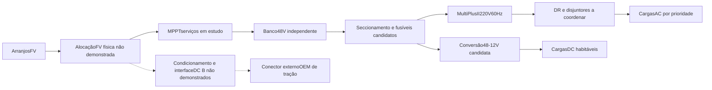

# Serviços48V — verificação elétrica e comando de referência

Modelo acadêmico condicional em `entregas/desenvolvimento_2026-11-09/protecoes_fixacoes/`; não é diagrama liberado para instalação. Dados comuns em `config/parametros_globais.yaml:development.electrical_detail`.

As setas de alocação não autorizam conectar a saída de um MPPT48V ao packHV. Não existe seta de energia armazenada entre os bancos. EntradaAC externa não participa da missão. Retornos de potência são cabos dedicados; chassi não é retorno de serviço por premissa.

O [manual MultiPlusII230V](https://www.victronenergy.com/media/pg/MultiPlus-II_230V/en/installation.html) recomenda200A e70mm² para o48/5000, na categoria de comprimento indicada. O pontoPE deve manter equipotencialização, e o relé internoN–PE participa da operação isolada. O manual admiteDRtipoA. Esses dados não selecionam automaticamente bitola/DR/disjuntor para a instalação brasileira ou comprovam a proteção de todos os aparelhos; pontos de conexão ao chassi, corrente de fuga e ensaios permanecem necessários. Não acrescentar ponteN–PE externa arbitrária nem interferir noHV OEM.

A triagem calculou324casos de carga constante com queda no cabo resolvida simultaneamente com I=P/V:500–4000W,43,5/48/53,5V,70/95/120mm²,20/40/90°C e0,4/4/10m de laço. Corrente10,384–102,936A; resíduo elétrico≤1,24e−12W. Não é verificação de ampacidade ou de partidas. No novo trajetoCAD de1,78395m de laço com20%folga,70mm²/90°C/4000W/43,5V dão102,306A e5,864W perdidos.

O [manualMPPT150/60](https://www.victronenergy.com/media/pg/Manual_SmartSolar_MPPT_150-60_up_to_250-70/en/installation.html) informa70–80A para fusível do lado bateria. Candidatos de estudo: JLLN200 eJLLN080. A [fichaLittelfuse2025](https://www.littelfuse.com/assetdocs/jlln-datasheet?assetguid=3a7bc9bf-d932-4401-bdc7-b39f302195cf),páginas2–3, documenta125VDC/20kADC para essas faixas. Não confundir a interrupçãoAC200kA com o limiteDC.

As144faltas usam Rinternamódulo hipotética1/5/20/50mΩ,3módulos paralelos e resistência de cabo, incluindo falta junto ao barramento. Corrente2,274–160,5kA;56casos excedem20kA. Não há previsão de corrente real ou garantia de limitação peloBMS. Sem resistência de cabo, limitar53,5V/3módulos a20kA exigiriaRpor módulo≥8,025mΩ, condição não verificada. É preciso obter impedância real e I²t/curvas de abertura/fadiga de fusível/conectores antes de concluir coordenação. O orçamento adiabático calculado de cobre40→90°C não substitui I²t total de interrupção de fabricante ou método normativo.

A máquina de estados em `motorhome.protecoes.GerenciadorCargas` recebe um pedido de estágio0–3. Os limiaresSOC continuam **null**; não são números arbitrados como ajusteBMS. Estágio0 libera a fila gerenciada,1retira cargas adiáveis,2preserva só prioritárias,3inibe todas. FalhaBMS/medida/atuador travaOFF até reset e condição válida; recuperação tem temporização de ensaio30s, não ajuste aprovado de produto. Foram simuladas256combinações de pedidos/estágios e6históricos de falha, com bloqueio de picos desconhecidos e intertravamento de grandes cargas. Poder comandar não comprova corrente de partida ou contator instalado. Um contator colado gera pedido de inibição; sua abertura física só pode ser garantida por arquitetura independente e ensaio, ainda ausentes.

A [integração oficialUS5000–Victron](https://www.victronenergy.com/live/battery_compatibility:pylontech_phantom) exigeGX comCAN-BMS eDVCC. Portanto, a combinação anterior ainda está incompleta. Essa dependência comercial é registrada emA04/A15 para compatibilizar comDEC056; nenhumgateway/central ou custo novo foi incorporado automaticamente, e não se atribui uso veicular comprovado aoUS5000. A tabela de mínimo de módulosUS2000 do manual não foi transplantada como quantidadeUS5000.

Fixações:648casos do grupo elástico de4parafusos,1/3/5g e0/0,1/0,25m de excentricidade,chapas2/3/4mm. Cargas locais dos reservatórios são avaliadas separadamente, sem somar todaágua à massa global. Maior utilização de cisalhamento dos parafusos0,622; esmagamento das chapas2,236,com10casos>1. Não adotar indiscriminadamente chapa2mm;redistribuição/espessura/apoio devem satisfazer o caso correspondente. Material235MPa/parafuso640MPa/fator2 são hipóteses de estudo. Tração,prying,pré-carga,fadiga,arrancamento e reação na carroceria continuam fora do modelo; não autoriza furar ou reforçar a van.

## Seleção provisória que trata a comunicaçãoBMS

Após comparar o modelo regular,Smart eGX,foi selecionado provisoriamente **MultiPlus-II GX48/5000/70-50**. A [introduçãooficial](https://www.victronenergy.com/media/pg/MultiPlus-II_GX/en/introduction.html) documentaGX evisor incorporados;assimnão se desenvolve ou acrescenta central própria/gateway externo sobDEC056. A [configuração](https://www.victronenergy.com/media/pg/MultiPlus-II_GX/en/configuration.html) admite220V/60Hz. A [especificação](https://www.victronenergy.com/media/pg/MultiPlus-II_GX/en/technical-specifications-mp-ii-gx-230v.html) dá31kg/565×323×148mm,4000/3700W e18Wvazio. CabeamentoCAN-BMS500kbps comcabotipoA,VE.Direct paraMPPT,DVCC efirmwares compatíveis são requisitos documentados,sem alegar ensaio. O preço da varianteGX não é o preço do modelo regular. A saídaAC-out2 que desliga em modo bateria não será usada como atalho para alimentar o boiler durante missão solar. Estágios individuais ainda exigem atuadores/comando a validar;terGX nãoimplementa automaticamente a máquina de estados.

A massa integrada passa3974,02553kg(+1kg),com reexecução dos modelos dependentes. Os cálculos/massas3973kg acima identificam o estado anterior do mesmo estudo,agora substituído pelos arquivos regenerados.

## Redimensionamento de interfaces locais e elasticidade 3D

`redimensionar_fixacoes.py` amplia os648casos históricos no plano para6equilíbrios espaciais. A interface rígida distribui esforços por molas iguais em3direções; as reações normais negativas são compressão no apoio, sem atribuir tração negativa ao parafuso. Cada geometria recebe216casos (1/3/5g horizontal, sinais/direções,±1g vertical,CG0,15/0,35/0,60m,excentricidade0/0,10/0,25m). São hipóteses, não requisitos de homologação. Demanda completa por componente/geometria fica nos54CSV. Água100/70/20L e boiler15L são máximos locais independentes; a água do boiler provém do inventário existente, sem soma global.

Comparadas378alternativas:18componentes×3grupos×7espessuras4–20mm. Critérios explícitos: tensão equivalente do parafuso com tração/cisalhamento, esmagamento no furo, cisalhamento até borda, seção líquida e envelope conservador flexão/cisalhamento de tira local. Materiais continuam hipóteses235/640MPa/fator2. Há18seleções provisórias com utilização≤0,97135 no modelo. Isso trata as falhas das chapas anteriores dentro do modelo ampliado, sem apagar os10casos reprovados históricos. Prying, pré-carga, contato unilateral, fadiga, soldas e arrancamentoOEM permanecem fora do cálculo. Cama_colchao é retenção do colchão em movimento, não estrutura da cama ocupada.

`verificar_chapas_3d.py` resolve elasticidade linear3D por tetraedros lineares em tiras representativas do inversor e tanque, com4malhas por tira (4/2,5/1,5/1mm) e quinta malha0,75mm no inversor,engaste ideal e tração uniforme na face livre. Salva malha,deslocamentos,tensor de tensões e vonMises emNPZ. Resíduos máximos de força1,22e−10N/momento3,69e−12Nm;2U=W externo em todos os9casos. A variação final de deslocamento é1,547%/1,817%:ambas as tiras satisfazem critério de estudo2% após refinamento adicional do inversor. Picos no engaste aumentam com refinamento e **não são resistência validada**. ComparadorTimoshenko é referência de ordem de grandeza, não solução exata da geometria3D; as tiras espessas não justificam usar Euler-Bernoulli como validação.

As18chapas locais perfuradas foram exportadas emSTEP,em mosaico externo ao veículo,com volume total0,00710205m³ e55,7511kg de aço estimado. Não representam pontos de perfuraçãoOEM. A massa líquida de substituição de suportes é desconhecida, portanto a massa-base3974,02553kg foi preservada. Uma sensibilidade separada acrescenta conservadoramente todas as chapas:4029,77663kg,CGx2,03925/z0,92645m,eixos1993,1696/2036,6070kg,margemPBT220,22337kg. Sem limites por eixo documentados, não há conformidade demonstrada. Consumo plano40/80km/h passa0,225064/0,405985 para0,227089/0,408010kWh/km;acréscimo14,1745kWh de tração em7000km. Serviços e interface solar/DC não foram alterados, e não foi inferido tempo de missão para essa sensibilidade.

Resultados em `entregas/desenvolvimento_2026-11-09/fixacoes_redimensionadas/`. Entradas rastreadas em `development.mounting_redesign` na fonte única; não há seleção de fabricante, preço ou compra de chapa/parafuso comprovados.

A comparação usa grupo em plano local genérico;não transfere furação/orientação diretamente ao produto comercial. Em particular,a parede vertical do inversor exige transformar gravidade/esforços ao plano real e obter a furação admitida. A sensibilidadeCG posiciona chapas sob as caixas como hipótese de massas,sem ser desenho de montagem.
