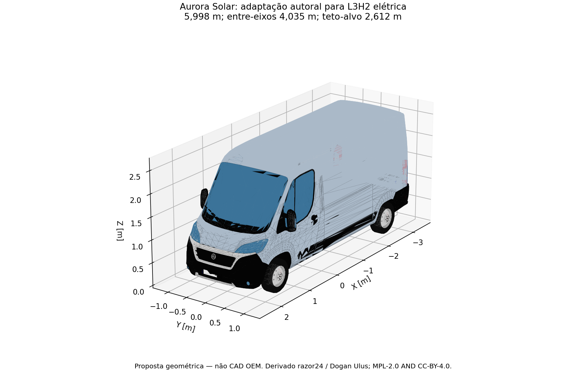
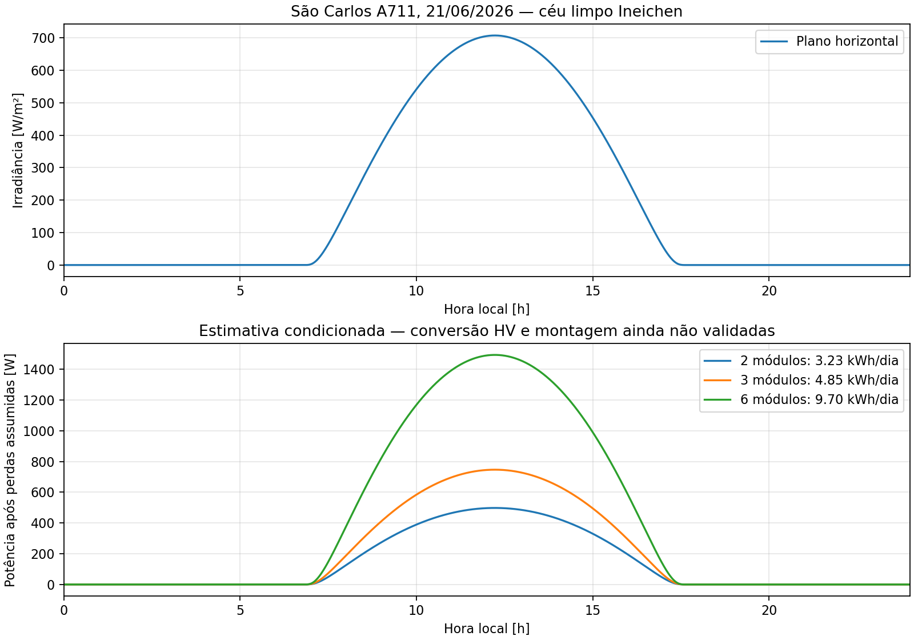
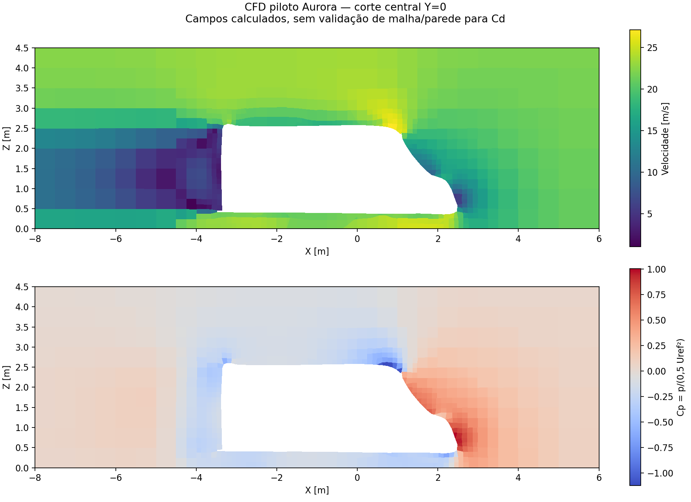
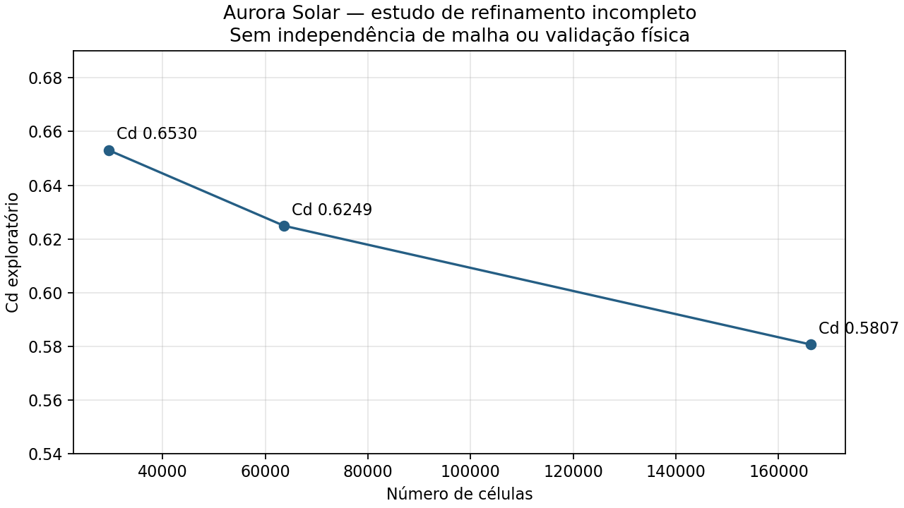
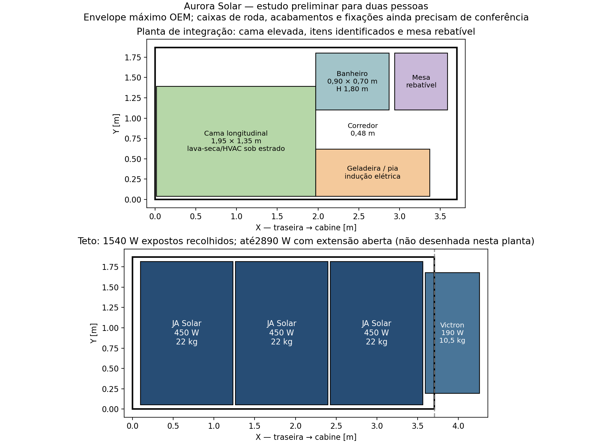
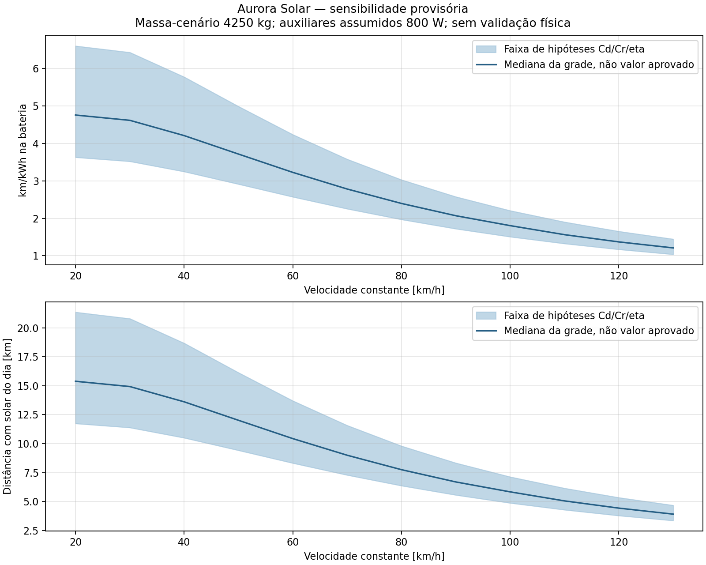
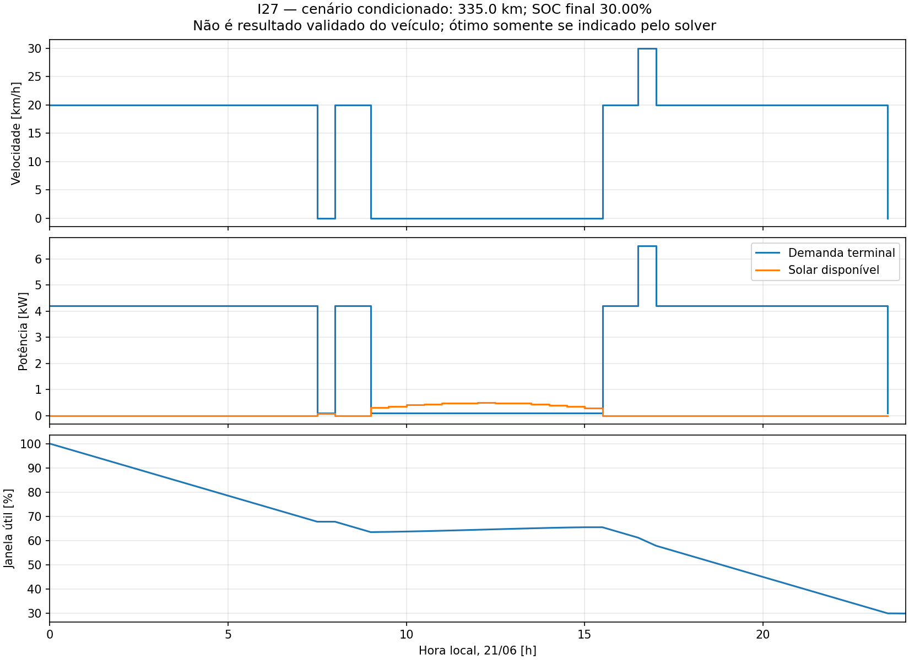
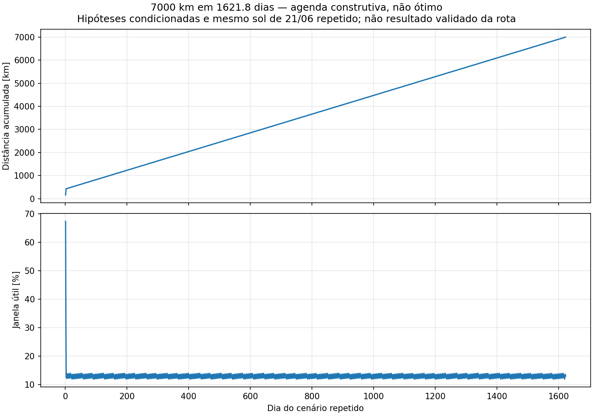

# Freios — atualização de 26/10/2026

[Campo térmico r–z](freios_campo_freio.png), [histórico](freios_historico_freio.png)
e [dados/proveniência](resumo_freios.json). Simulação da frenagem oficial,
com geometria/partição condicionadas, refinamentos e série analítica independente.
[Pesquisa, equações e limites](../../docs/FREIOS_2D.md). I03/I33 ainda parciais;
não representa aprovação do freio OEM nem compatibilidade da peça candidata.

# Atualização térmica — 26/10/2026

Novos `resumo_cabos.json`/`resumo_radiador.json`, camposCSV, figuras e três malhas por método.
[Hipóteses, fontes e resultados](../../docs/CABOS_E_RADIADOR_2D.md). São estudos condicionados; I30/I35 ainda parciais.

# Aurora Solar — revisão parcial de 24/10/2026

**Atualização25/10: [abrir o visualizador equipado](visualizador.html).** Agora inclui
tração e elétrica com23seletores: use a vista técnica para retirar a carroceria/interior,
ou selecione A/C para isolá-lo. [STEP tração/serviços](tracao_e_servicos.step),
[vista da tração](cad_tracao.png), [elétrica de serviços](cad_eletrica_servicos.png)
e [relatório da integração](../../docs/CAD_TRACAO_E_SERVICOS.md).
208sólidos novos; dimensões de tração estimadas, componentes de serviços documentados.
Interior157sólidos com induçãoIE3TP220V60Hz2000W, banco de serviços10,24kWh.
Subtotal3373,355kg antes de itens faltantes; consumo residencial assumido5,27651kWh/dia
sem secagem. [Resultados atuais](resumo_integracao_eletrica.json) e
[fontes/hashes](proveniencia_eletrica.json). Os números anteriores abaixo são históricos;
não representam a nova configuração completa. Logo/pintura ficam após a parte técnica.

**Projeto em desenvolvimento. Não é entrega final dos 35 itens.**

[Abrir visualizador 3D offline](visualizador.html): carroceria detalhada, vistas, triângulos, módulos e reservas internas. Abra o HTML no navegador. [Método, pesquisa de CAD online e checagem do banheiro](../../docs/CAD_ONLINE_E_VISUALIZACAO.md).

[Abrir malha GLB adaptada](aurora_L3H2_proposta_m.glb). Comprimento-alvo 5,998 m, entre-eixos-alvo 4,035 m, teto-alvo 2,612 m. Proposta autoral derivada de modelo detalhado existente; não CAD homologado Fiat. A malha visual continua aberta; uma versão separada reparada serviu somente ao piloto CFD.

Estimativa de céu limpo em São Carlos A711, 21/06/2026: **3,23 kWh/dia com dois módulos** ou **4,85 kWh/dia com três**, após perdas assumidas. Eficiência de conversão HV, montagem, sombras e interface BMS não estão validadas. Não equivale à autonomia do motorhome. Entradas em [solar_proposta.yaml](../../config/solar_proposta.yaml), resultados e hipóteses em [resumo_solar.json](resumo_solar.json).

Campos efetivamente calculados: piloto com 29.527 células, solver atingiu critérios de resíduo em 108 iterações, sem estudo de independência de malha/camadas/y+ nem validação experimental. **Cd exploratório pós-processado: 0,653; não validado.** Ver [coeficientes e limites](coeficientes_piloto.json). Ver [resumo do piloto](resumo_cfd_piloto.json).

Três malhas sem camadas: 29.527 / 63.668 / 166.212 células; Cd exploratório 0,6530 / 0,6249 / 0,5807. A última mudança é de 7,07%, portanto **não há independência de malha demonstrada**. [Logs, hashes e limitações](comparacao_cfd.json). Refino com camadas divergente foi rejeitado.

Para fontes, método, comandos, limites e o que falta, consultar [registro de execução](../../docs/AVANCO_2026-10-24.md) e [revisão dos 35 itens](../../docs/REVISAO_35_ITENS.md). Dados globais aprovados permanecem intactos. Testes automatizados verificam implementações, não aprovam a engenharia do veículo.

## Atribuição da geometria

Modelo derivado: Fiat Ducato 2014, razor24 (2019), Dogan Ulus (2025), OpenX Assets release 20261015. Licenças conjuntas **MPL-2.0 AND CC-BY-4.0**, textos preservados nesta pasta. Fonte [OpenX Assets](https://github.com/vevalabs/openx-assets/releases/tag/20261015); código-fonte Blender e histórico em [repositório original](https://github.com/vevalabs/openx-assets/tree/1a63f13b5cfee3e01207a84b13b40fc172d92a95/src/vehicles/fiat_ducato_2014). Mudanças: seleção de exterior, rotação dos eixos, alongamento da região de carga, elevação do teto e translação rígida das rodas; todos os passos no [script](../../scripts/adaptar_educato.py). Não se afirma vínculo/endosso dos autores com este projeto.

## Ocupação preliminar

Reservas geométricas sem sobreposição retangular; não comprovam encaixe real nem seleção completa dos equipamentos. Interferências, ergonomia, montagem de teto e carga por eixo seguem pendentes.

O topo do banheiro anterior interferia no teto curvo. A reserva passou para 0,90×0,76×1,80 m; [81 raios de triagem](triagem_banheiro.json) tiveram folga externa mínima de 33 mm. Isso não resolve espessuras/isolamento, altura livre e colisão completa.

## Energia e agendas condicionadas

324 combinações explícitas de hipóteses, sem promover Cd/Cr/rendimento/massa a dados aprovados. [Tabela CSV](sensibilidade.csv), [resumo](resumo_sensibilidade.json) e [equações/métodos](../../docs/ENERGIA_E_OTIMIZACAO.md).

I27: **335 km na grade/modelo condicionado**, SOC inicial100% → final exatamente30%. O limite8h pertence a I29; I27 usa o dia completo. [Agenda](agenda_i27.csv), [hipóteses e solver](resumo_agendas.json). Faltam acelerações e potência mecânica real do motor; o gráfico mostra demanda elétrica terminal.

I29: foi construída e verificada uma agenda de 7000 km, máximo8h/dia, sem recarga externa, em **1621,77 dias** no cenário que repete o mesmo sol de São Carlos/21 de junho todos os dias. **Não é tempo mínimo nem previsão da rota real.** [Resumo, balanço e hash do CSV completo em cache](resumo_viagem_7000km.json). O otimizador de menor tempo foi implementado e testado em casos menores; a missão física continua aberta.

Verificação desta continuação: **96 testes passaram**, ruff dos arquivos novos/alterados passou e visualizador testado em Chromium sem requisições externas. Nenhum item foi promovido a aprovado.

## Inclusões de 25/10/2026

[Memorial PDF de revisão](../../output/pdf/memorial_revisao_aurora.pdf): 13 páginas, cerca de1MB; nenhum resultado foi declarado aprovado. [Cabine](cabine_termica.png), [JSON dos48cenários](resumo_cabine.json) e [CSV temporal](cabine_timeseries.csv): I31/I32 condicionados, conforme [método e fontes](../../docs/CABINE_E_HVAC.md). [Fontes consultadas](fontes_conforto_consulta.json) registra também a falha HTTP403 do download Armacell e o manual Dometic APAC que não foi adotado como ficha do modelo EMEA.

O manifesto de hashes agora cobre os arquivos atuais e referencia o PDF fora desta pasta. Parciais24/35, nenhum aprovado. O relatório não é a entrega final aos professores.

## Atualização posterior: cobertura ampliada e interior equipado

[Abrir visualizador atualizado](visualizador.html): comece por **Ver interior equipado**; use **Retirar cama** ou selecione a lava-seca/HVAC para ver instalações inferiores. A cobertura inicial é a **fixa1540W**, estimada97,7kg antes de ferragens. **Comparar extensão** e **Abrir extensão** mostram a alternativa2890W estacionada, cuja montagem empilhada171,2kg está condicionada ao teto/fixações.

[Interior STEP](interior_equipado.step), [cobertura fixa STEP](cobertura_fixa.step), [extensão recolhida STEP](cobertura_recolhida.step), [extensão aberta STEP](cobertura_aberta.step). Modelos autorais dimensionados por fontes indicadas; não CAD OEM. Os GLB correspondentes estão nesta pasta. [Figura superior](cad_solar_recolhido.png), [interior](cad_interior.png), [lava-seca e instalações inferiores](cad_lava_seca.png).

[Geração ampliada](expansao_solar.png), [resultados e hipóteses](resumo_expansao_solar.json), [orçamento parcial de massa](orcamento_massa_parcial.json) e [fontes/reprodução/limites](../../docs/EXPANSAO_SOLAR_E_INTERIOR.md). Potência e energia agregadas não comprovam transferência ao pack400V. O caso térmico de cabine continua condicionado ao envelope anterior; o perfil de habitação e a nova cobertura ainda não foram integrados à missão física7000km.

O [memorial atualizado](../../output/pdf/memorial_revisao_aurora.pdf) tem16páginas/~1,55MB. A descrição anterior de13páginas e dois painéis é histórica.112testes passaram;26itens em desenvolvimento parcial/9nãoiniciados/0aprovados. Não é projeto concluído nem entrega aos docentes.
